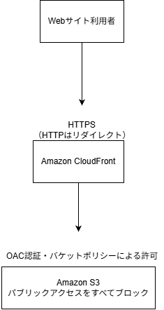

# AWS S3 + CloudFront 静的Webサイト構築

## 1. プロジェクト概要

Amazon S3とAmazon CloudFrontを利用し、
静的WebサイトをHTTPSで配信する環境を構築しました。

AWS SAAで学習した知識を実際の構築に活かすための
個人学習プロジェクトです。

## 2. AWS構成図

## 3. 使用技術

- Amazon S3
- Amazon CloudFront
- Origin Access Control（OAC）
- AWS IAM
- HTML / CSS

## 4. 構築内容

1. S3バケットを作成
2. S3のパブリックアクセスをすべてブロック
3. index.htmlをアップロード
4. CloudFrontディストリビューションを作成
5. OACを設定してS3へのアクセスを制限
6. デフォルトルートオブジェクトを設定
7. HTTPからHTTPSへのリダイレクトを設定

## 5. 設計上の工夫

### セキュリティ
S3を直接公開せず、CloudFront経由で配信する構成にしました。

OACとS3バケットポリシーを使用して、
CloudFrontからの読み取りを許可しています。

### HTTPS通信
HTTPアクセスをHTTPSへリダイレクトする設定を行いました。

## 6. 動作確認

- CloudFront経由でWebページが正常表示されることを確認
- CloudFrontのトップURLからindex.htmlが表示されることを確認
- HTTPからHTTPSへのリダイレクトを確認
- S3オブジェクトURLへの直接アクセスでAccessDeniedを確認

## 7. 今後の改善予定

- Terraformによるインフラ構築の自動化
- CloudWatchを利用した監視設定
- 構築・削除手順のドキュメント化

## 8. 備考

本リポジトリは個人学習用の成果物です。
顧客案件として構築したものではありません。
